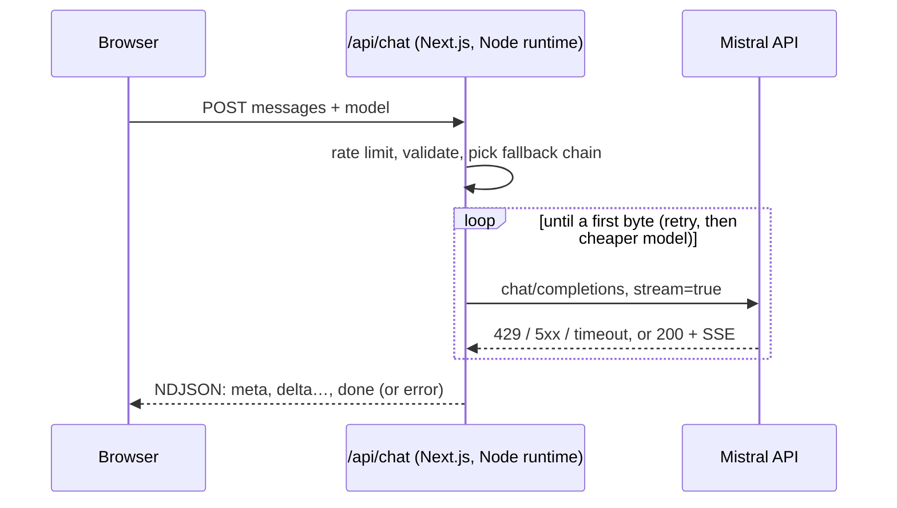

# Mistral Chat

A small streaming chat on [Mistral AI](https://mistral.ai), built with Next.js and TypeScript, and written to behave well in front of real traffic: it keeps the API key on the server, limits what a visitor can spend, falls back to a cheaper model when one is saturated, and says clearly what happened when something fails.

**Live demo:** https://mistral-chat-xi.vercel.app/

## What it does

- **Streams answers** token by token, with Markdown and code blocks.
- **Shows how each answer was produced:** the model that answered, whether it fell back from the one requested, the time it took and the tokens it used.
- **Falls back and retries before the first byte.** On a 429, a 5xx or no first byte within 20 s, it retries once with backoff and jitter, then moves to the next cheaper allowed model. It never switches model once text has reached the user, which would mix two answers.
- **Protects the key and the bill:** the browser only talks to `/api/chat`; the server accepts only allowed models, caps the conversation size and the output tokens, and rate limits each client.
- **Cancels end to end:** pressing Stop aborts the request to Mistral too, instead of letting it run.
- **Fails readably:** errors come back as `{ "error": { "code", "message" } }` with a message fit for the user and no upstream internals; a stream that breaks halfway ends with an explicit error event.
- **Logs one structured line per request:** outcome, requested and used model, every attempt, time to first token, total time and token usage.
- **Keeps conversations in the browser** (localStorage), never on the server.

## How it works



The API turns Mistral's server-sent events into a small event protocol, one JSON object per line:

| Event | Meaning |
|---|---|
| `{"type":"meta","model":"…","fallbackFrom":"…"}` | Which model is answering, and which one it replaced |
| `{"type":"delta","text":"…"}` | Next piece of the answer |
| `{"type":"done","ms":…,"usage":{…}}` | The answer is complete |
| `{"type":"error","code":"…","message":"…"}` | The stream broke after it started |

Passing Mistral's raw stream through would leave the browser without the model actually used, the usage, or a clean way to report a failure halfway.

## Limits

| Setting | Value |
|---|---|
| Models | `mistral-small-latest`, `mistral-medium-latest` (set `ALLOWED_MODELS` to change) |
| Conversation | up to 30 messages, 4,000 characters per message, 24,000 in total |
| Answer | up to 1,024 tokens |
| Rate limit | 8 requests per minute per client IP |

The rate limiter lives in memory, so on a serverless platform each instance counts separately. That is enough to stop casual abuse of a demo; a shared store such as Redis would be the next step for a real product.

## Run it locally

Requires Node.js 20 or later.

```bash
npm install
cp .env.example .env.local   # then set MISTRAL_API_KEY
npm run dev                  # http://localhost:3000
```

No key? Set `MOCK_MISTRAL=1` instead: the API streams a canned answer, so the whole UI can be tried offline. It is ignored whenever `MISTRAL_API_KEY` is set.

```bash
npm run typecheck
npm test
npm run build
```

## Project structure

```
app/
  api/chat/route.ts     API: rate limit, validation, fallback, NDJSON stream, logging
  page.tsx              Chat page
lib/
  config.ts             Models, limits, fallback chain
  validate.ts           Request validation
  mistral.ts            Mistral call with retries, timeout and fallback
  sse.ts                Incremental SSE parser
  rate-limit.ts         Sliding-window rate limiter
  events.ts             Event protocol shared by server and client
  mock.ts               Canned stream for local development
hooks/useChat.ts        Client state, streaming, stop, local persistence
components/             Message, composer, empty state
```

## Tests

Vitest covers the validation rules, the rate limiter, the SSE parser, the API route (streaming, fallback order, non-retryable errors, a stream that breaks halfway, rate limiting, mock mode) and the chat page (streaming render, server errors, Stop). CI runs type checking, tests and a production build on every push.
